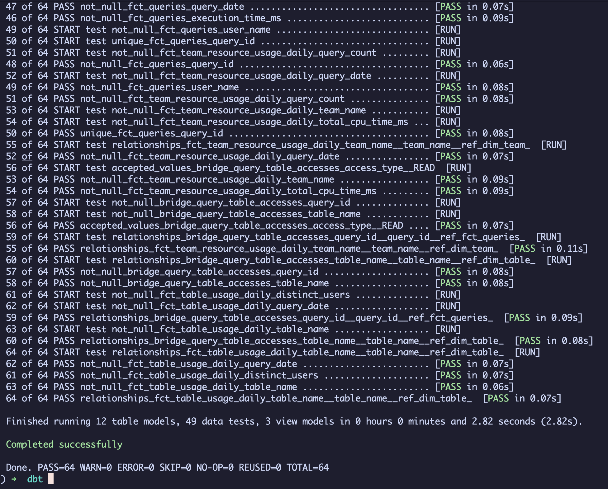
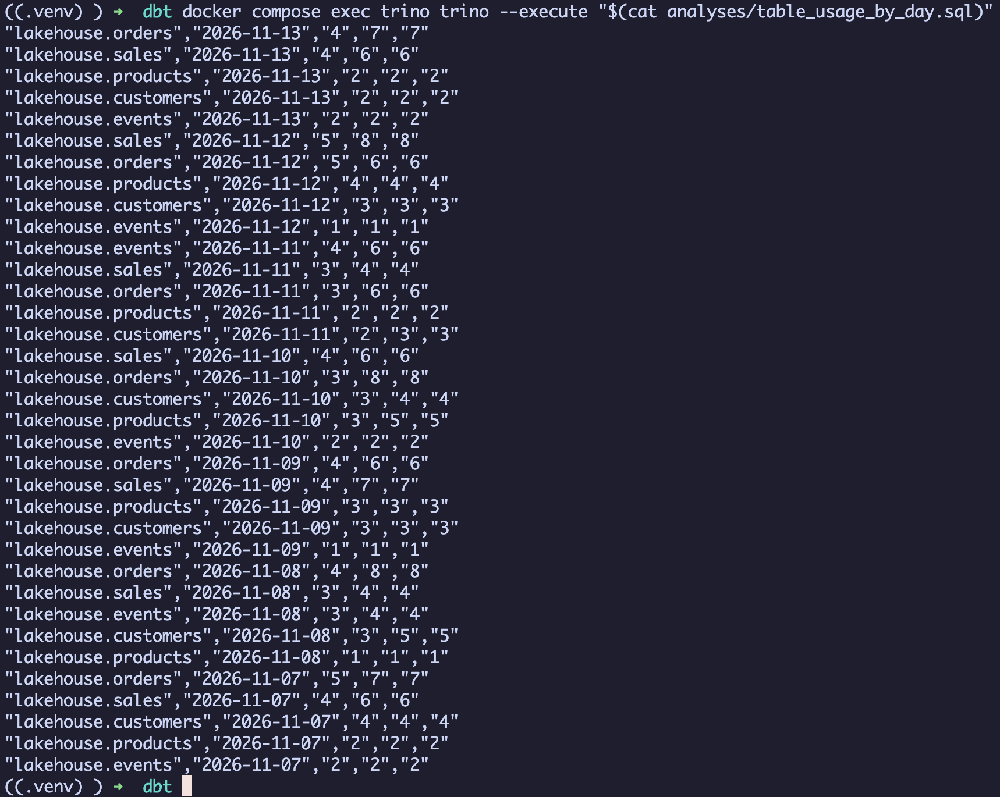
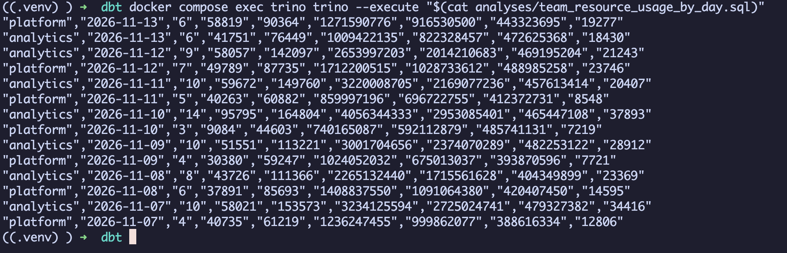

# JetBrains Metadata Data Warehouse

## Overview

A local demonstration of a metadata warehouse for Trino query events stored in Apache Iceberg on S3-compatible storage.

It answers two analytical questions:

1. How many distinct users access each warehouse table over time?
2. How much compute resource does each team consume over time?

The implementation uses synthetic data and a local Docker environment.

## Architecture

```text
Synthetic data
      |
      v
Python loader
      |
      v
Trino + Apache Iceberg
      |
      v
MinIO (S3-compatible storage)
      |
      v
dbt transformations
      |
      v
Reporting tables
  - Daily table usage
  - Daily team resource usage
```

### How it works

1. Python generates synthetic query events, users and table metadata.
2. The loader ingests data into Iceberg using `MERGE` to prevent duplicates.
3. dbt transforms the data through staging, core and reporting layers.
4. Reporting models provide daily table usage and team resource consumption.

The dataset contains 105 query events, 5 users, 2 teams and 5 tables.

**Technologies:** Python, Trino, Apache Iceberg, MinIO, dbt-trino and Docker Compose.

For a more detailed explanation of the architecture, data model, assumptions and design decisions, see [`docs/architecture.md`](docs/architecture.md).

## Production approach

Based on my experience at Beeline working with dlt, dbt and data pipeline orchestration (dagster), I would use:

- Incremental ingestion with stable query identifiers and deduplication.
- Incremental dbt models with rolling-window processing for late-arriving events.
- Selective rebuilding of affected reporting partitions.
- An orchestration tool for scheduling, dependencies, retries and monitoring.

For this test task, Python ingestion with Iceberg `MERGE` and full dbt rebuilds is sufficient. Production incremental processing would be more efficient and reliable at larger scale.

## Running locally

**Prerequisites:** Python 3.12.16 (pyenv), Docker Desktop and Docker Compose.

```bash
# Set up Python
pyenv install 3.12.16
pyenv local 3.12.16
python -m venv .venv
source .venv/bin/activate
pip install -r requirements.txt

# Start infrastructure
docker compose up -d

# Generate and load data
python data_generator/generate_data.py
python data_generator/load_data.py

# Build and test dbt models
cd dbt
dbt debug
dbt build
```

**Local services:**

- Trino: http://localhost:8080
- MinIO: http://localhost:9001

## Verification

All 64 dbt build nodes (models and tests) pass on the synthetic dataset.

### dbt build



### Table usage



### Team resource usage


